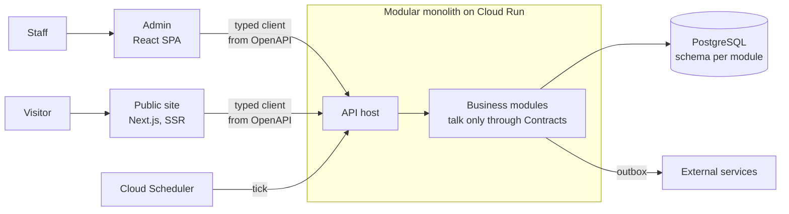

# Architecture Review Portfolio

How I review and improve the architecture of production systems: the checklist I use, a real before → after case, and the architecture rules I build against. Documents only: no code and no confidential client data.

**Who it is for:** tech leads, hiring managers and clients who want to see how I find architecture problems, decide what to fix and prove the result with numbers.

## Highlights

From a real review of a production ERP (14 → 19 November 2026):

- **Module contracts:** from none of 12 modules to every module talking only through its public contract.
- **Architecture tests:** from 9 partly covered modules to 30 test files that fail CI on a broken rule.
- **API contract:** from hand-written YAML to OpenAPI generated from code, with 437 endpoints in a reviewed snapshot.
- **Quality targets:** 18 written targets, measured monthly: availability 99.99 %, read P95 89 ms, all speed targets met.
- **Decisions:** from 5 ADRs to 21.

Details and evidence are in the [case study](case-study.md).

## Read it in 5 minutes

1. [case-study.md](case-study.md), "Before → after" tables: what was found, what was fixed, how it is now.
2. [checklist.md](checklist.md), "How I run a review": step 0, levels, marks and severity.
3. [docs/dependency-rules.md](docs/dependency-rules.md): every rule with the automatic check that enforces it.

## Contents

| Document | What it shows |
| --- | --- |
| [Case study](case-study.md) | Three reviews of one system, every finding with its fix and current status, one month of production numbers |
| [Review checklist](checklist.md) | 14 sections, from module boundaries and data to frontend and AI features, at Quick, Standard and Deep levels |
| [C4 diagrams](docs/c4.md) | System context and containers: who uses the system, what it talks to, what runs where |
| [Runbook: API returns 5xx](docs/runbook-api-5xx.md) | How I find the cause of server errors, step by step: health, recent changes, traces, dependencies |
| [Module map](docs/module-map.md) | How the system is split into modules and layers |
| [Dependency rules](docs/dependency-rules.md) | 17 rules, why each exists and which CI check enforces it |
| [Architecture decisions](docs/adr/README.md) | 5 ADRs with alternatives, consequences and when to revisit: modular monolith, module contracts, outbox, OpenAPI from code, idempotency |

## The architecture in one picture

**Stack:** .NET 10, ASP.NET Core Minimal API, EF Core, PostgreSQL, Google Cloud Run, Cloudflare, React, Next.js, Nx, OpenAPI.

## How I work

**With people.**

- **Decisions are made with the business.** I agree priorities and trade-offs with the business owner, and check workflows with the managers who use the system every day.
- **Discovery questions come first.** Before a new feature I ask short business questions: who uses it, how often, what must never go wrong, how fast, what it may cost. The answers become the specification and the quality targets.
- **Hard-to-reverse choices become ADRs,** so the reason survives after the conversation is forgotten.

**Three layers of review.**

| Layer | When | What it checks |
| --- | --- | --- |
| Automatic checks in CI | Every pull request | Module boundaries, layers, folder size, API contract drift, endpoint access and rate limits, documentation maps |
| Feature audit | After each feature | The whole feature against the [checklist](checklist.md) and the project rules, backend and frontend separately |
| System review | Periodically and before a big phase | The whole system at Quick, Standard or Deep level, with step 0 first: quality targets in numbers |

**Principles.**

1. **Targets first.** No verdict on speed or reliability without numbers.
2. **Facts, then decisions.** A review records what is there, with evidence. A separate step decides what to fix, when and at what cost.
3. **Rules become checks.** Every important rule becomes a test or a CI step, so it cannot quietly break again.

## Author

Built by [Vitaliy Tsiupin](https://www.linkedin.com/in/vitaliythupin/), full-stack .NET + React developer. I build and run production systems for small businesses, and review them with this checklist.
