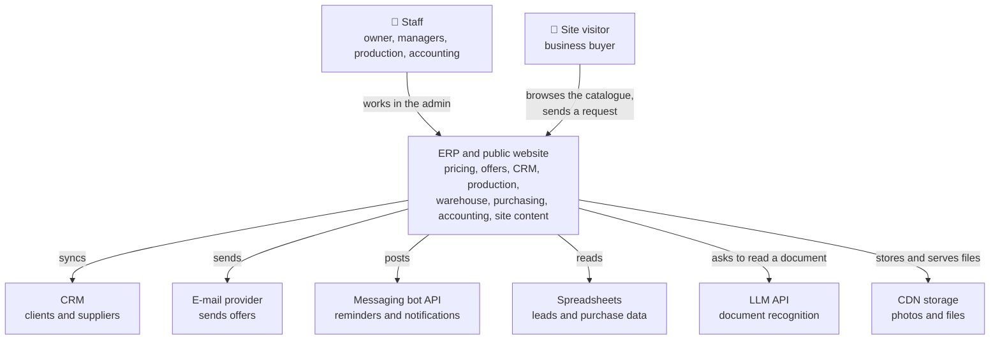
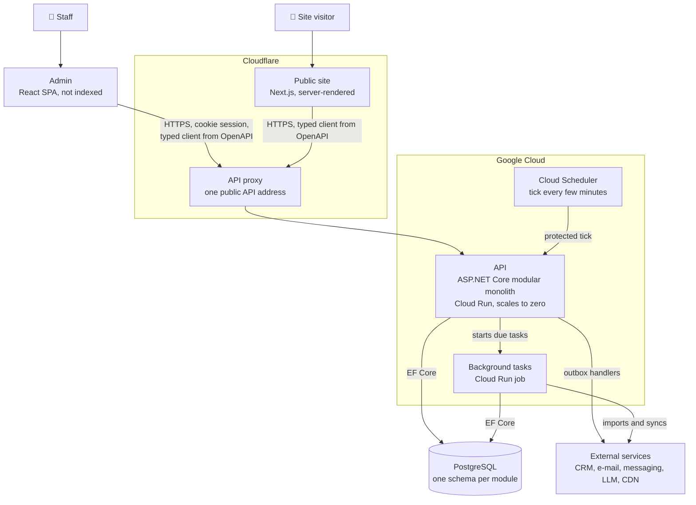

# C4 diagrams

Two levels of the [C4 model](https://c4model.com): **Context** shows who uses the system and which outside systems it talks to. **Container** shows the deployable parts and how they connect. The module level is in the [module map](module-map.md).

## Level 1: System context

## Level 2: Containers

| Container | Technology | Responsibility |
| --- | --- | --- |
| Admin | React, Nx | Staff work: catalogue, prices, offers, production, accounting, site content, access rights |
| Public site | Next.js on Cloudflare | Catalogue and product pages for search engines and buyers |
| API proxy | Cloudflare | One public API address in front of Cloud Run |
| API | .NET 10, ASP.NET Core Minimal API | All business rules, split into modules |
| Background tasks | .NET 10, Cloud Run job | Imports, syncs and long work, started by the tick |
| Cloud Scheduler | Google Cloud | Calls the tick, which sends the outbox and starts due tasks |
| Database | PostgreSQL | Each module owns its schema |
