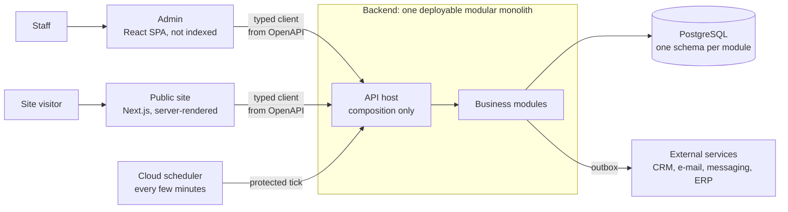
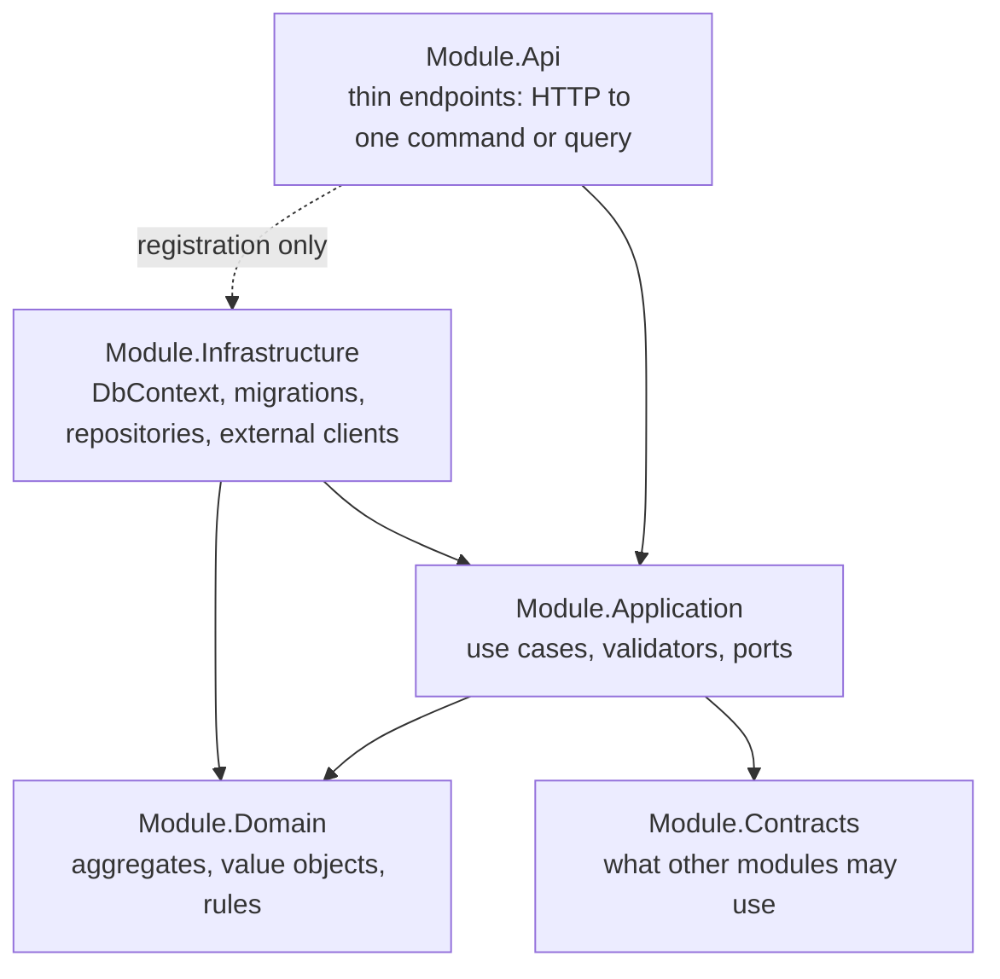

# Module map

## The system



- **One backend, many modules.** One ASP.NET Core application runs on Google Cloud Run. It is split into business modules, such as catalogue, orders, CRM, content and identity.
- **Two clients.** The admin is a React SPA for staff, kept out of search engines. The public site is Next.js, server-rendered for SEO. Both call the API through a client generated from the OpenAPI contract.
- **Background work without a resident process.** The host scales to zero, so there is no in-process timer. A cloud scheduler calls one protected tick endpoint. The tick sends the outbox and starts due tasks.

## One module

Every business module has the same five projects.



| Project | Owns |
| --- | --- |
| Domain | Aggregates, value objects, domain errors and events, business rules |
| Application | One folder per use case (command or query), validators, ports for persistence and integrations |
| Infrastructure | Its own database schema, migrations, repositories, external clients, implementations of its Contracts |
| Api | Minimal API endpoints grouped by feature, plus one registration call for the host |
| Contracts | Small read and command interfaces, their DTOs, integration events. This is the only part other modules may see |

Shared building blocks (outbox, result types, caching, base classes) hold no business rules.

## Inside a module

Folders follow features and aggregates, never kinds of classes:

```text
Module.Application/
└── Features/<Feature>/
    ├── Commands/<UseCase>/   command, handler, validator
    └── Queries/<UseCase>/    query, handler, read model
```

A folder holds at most six code files. When it would hold more, it is split by meaning into named subfolders.
